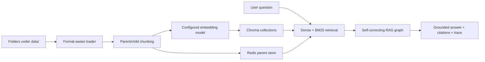

# Universal RAG

A domain-agnostic retrieval-augmented generation starter. Point it at folders of
documents and it exposes a cited chat API and web UI—without adding a new agent
or enum for every business domain.

## What changed from the original prototype

- Knowledge bases are discovered dynamically from `data/<name>/`; the fixed
  airline department router and multi-agent supervisor are gone.
- Omitting `knowledge_base` searches across every indexed collection.
- Dense and BM25 results are fused with reciprocal-rank fusion.
- The configured embedding model is now used explicitly for both ingestion and
  queries. The original implementation instantiated an embedding model but let
  Chroma silently use its own default.
- Markdown, text, reStructuredText, HTML, JSON, CSV, and PDF files are supported.
- Deterministic chunk IDs plus Chroma `upsert` make re-indexing repeatable.
- Retrieved text is treated as untrusted data and answers cite numbered sources.
- LangGraph, LangChain integrations, Chroma, FastAPI, Redis, Ragas, and build
  tooling are updated to their current major APIs and pinned versions.
- OpenAI calls use the Responses API; Azure OpenAI and a no-network mock mode
  remain available.

## Architecture



The graph uses a bounded retrieve → generate → critique loop. It rewrites and
retrieves again only when the answer is rejected, so latency is predictable and
there is no agent-to-agent routing overhead.

## Quick start

1. Copy the environment template and set credentials:

   ```bash
   cp .env.example .env
   ```

2. Add documents. Each first-level directory is one knowledge base:

   ```text
   data/
     product_docs/
       getting-started.md
       api.pdf
     policies/
       refunds.txt
   ```

3. Start infrastructure and applications:

   ```bash
   docker compose up --build
   ```

4. Index every discovered knowledge base:

   ```bash
   docker compose exec api python scripts/ingest.py --all --data-dir /data
   ```

5. Open `http://localhost:3000`.

The default `LLM_PROVIDER=mock` and `EMBEDDING_PROVIDER=mock` are useful for wiring checks but does not generate
real answers or meaningful semantic retrieval. Set `EMBEDDING_PROVIDER=openai` or `local` and `LLM_PROVIDER=openai` and `OPENAI_API_KEY`, or configure the
Azure variables, for actual generation.

## Deploy on Render

The repository includes `render.yaml` for a free Render web service and static
site backed by Neon Postgres, Upstash Redis, and Chroma Cloud. See
[`docs/render-deployment.md`](docs/render-deployment.md) for account setup,
secret values, deployment order, and free-tier limitations.

## API

List indexed knowledge bases:

```bash
curl -H "X-API-Key: $API_KEY" \
  http://localhost:8000/api/v1/knowledge-bases
```

Query a specific knowledge base:

```bash
curl -X POST http://localhost:8000/api/v1/chat \
  -H "Content-Type: application/json" \
  -H "X-API-Key: $API_KEY" \
  -d '{"message":"What is the refund window?","knowledge_base":"policies"}'
```

Search all knowledge bases by omitting the optional field:

```bash
curl -X POST http://localhost:8000/api/v1/chat \
  -H "Content-Type: application/json" \
  -H "X-API-Key: $API_KEY" \
  -d '{"message":"What changed in the latest release?"}'
```

For SSE, use `POST /api/v1/chat/stream` with the same request body.

## Local development

Backend:

```bash
cd apps/backend
uv sync --extra dev
uv run pytest
uv run ruff check app tests
```

Frontend:

```bash
cd apps/frontend
npm ci
npm test
npm run build
```

## Operational notes

- Changing `EMBEDDING_PROVIDER` or `EMBEDDING_MODEL_NAME` requires rebuilding
  the affected collections; embedding spaces are not interchangeable.
- `BAAI/bge-m3` is the default local multilingual model. It is larger than the
  old English-only model; choose a smaller model if memory is constrained.
- Chroma is pinned rather than using `latest`, stores data at `/data`, and uses
  the current `/api/v2/heartbeat` health check.
- The database column named `department` is retained for conversation migration
  compatibility; it now stores a knowledge-base slug or `all`.

## License

See the repository license, if present.

## Local startup and credentials

Compose runs Alembic before the API, waits for the worker health key before
seeding, and serves HTTP without requiring local certificates. Open
`http://localhost:3000` or `http://localhost`. Vite and Nginx attach the API key
server-side; local browsers do not need a `VITE_API_KEY`. Bindings default to
loopback. For a public deployment, put TLS and user authentication at the edge.
The shared demo key does not provide user or conversation isolation.

For standalone local development, `.env` belongs in `apps/backend/` and the
frontend Vite server reads `API_KEY` from its process environment. Copy the same
key to that environment when changing the backend default. `docker compose`
reads the root `.env` and forwards the backend provider settings explicitly.

## Optional providers and evaluation

The base install supports offline wiring and cloud embeddings without Torch or
Ragas. For local BGE embeddings or reranking, run `uv sync --extra dev --extra
local`. Linux/Windows resolve CPU Torch wheels. For Ragas, add `--extra
evaluation`; it uses an independent reference and complete passages. In Compose,
set `INSTALL_LOCAL=true` or `INSTALL_EVALUATION=true` and rebuild before selecting
those features. `RERANKER_MODEL` enables optional CPU cross-encoder ranking.

The Documents view uploads, deletes, rebuilds and reports indexing job progress.
It needs writable `/data`; Compose supports Linux `LOCAL_UID`/`LOCAL_GID` to match
bind-mount ownership. On hosts without persistent document storage, uploads do
not survive redeployment. Render's current free blueprint has this limitation.

New chat starts a fresh backend session. Saved sessions can be restored from
the sidebar. Each assistant answer retains its own complete numbered evidence.
Generation streams a draft; failed evidence checks replace it. Trace timings
include graph stages and reported graph token usage, not billing totals.

`/health` checks process liveness; `/ready` probes dependencies. Redis server
uses the published `8.2-alpine` image. See [benchmark instructions](benchmarks/README.md)
and [implementation record](docs/implementation-progress.md). `npm run test:e2e`
runs browser contracts; backend tests separately cover ingestion and persisted
streaming. CI also runs Docker startup, migration and proxy smoke checks.
