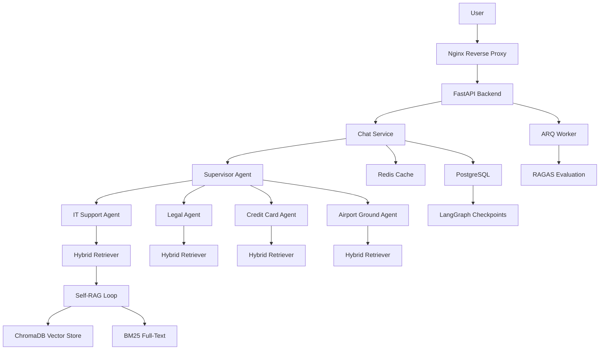

# SkyWing Airlines - Multi-Agent RAG System

[](https://www.python.org/downloads/release/python-3120/)
[](https://fastapi.tiangolo.com/)
[](https://langchain-ai.github.io/langgraph/)
[](https://react.dev/)
[](https://www.docker.com/)

Enterprise-grade multi-agent RAG system simulating airline department knowledge retrieval with LangGraph, FastAPI, and React. This project demonstrates a production-ready architecture for coordinating specialized AI agents to provide accurate, grounded answers from complex organizational knowledge bases.

---

## 🏗 System Architecture

The SkyWing system is designed as a modular, containerized ecosystem that balances high-performance retrieval with sophisticated agentic reasoning. Below is a detailed breakdown of the core architectural layers:

### 1. Multi-Agent Orchestration Layer
At the heart of the system is a hierarchical agent coordination model built with **LangGraph**.
- **Supervisor Agent**: Utilizes `langgraph_supervisor` to act as an intelligent router. It parses natural language queries to identify the relevant domain (IT, Legal, etc.) and delegates to the appropriate specialized worker.
- **Specialized Workers**: Four independent ReAct agents, each fine-tuned through their system prompts to handle department-specific terminology and procedures.

### 2. Intelligent Retrieval Layer (Self-RAG)
To solve the common "hallucination" problem in standard RAG, we implement a **Self-RAG loop**. This state machine doesn't just retrieve; it evaluates its own output.
- **Critique Node**: Uses the LLM to verify if the generated answer is strictly supported by the retrieved context.
- **Adaptive Querying**: If the initial retrieval is insufficient, the **Rewrite Query** node reformulates the search parameters and triggers a second retrieval attempt (up to 3 iterations).

### 3. Hybrid Storage & Retrieval Strategy
We use a "Best of Both Worlds" approach for document fetching:
- **Vector Search (ChromaDB)**: Captures semantic meaning and intent, allowing the system to find relevant information even when keywords don't match exactly.
- **Keyword Search (BM25)**: Ensures that specific technical terms, error codes, and policy IDs are found with 100% precision.
- **RRF Fusion**: Reciprocal Rank Fusion merges these two ranked lists into a single, high-fidelity context stream.

### 4. Enterprise-Grade Memory
Memory is handled in three distinct tiers to mirror professional human workflows:
- **Stateful Execution (Short)**: Active graph state passing variables between nodes.
- **Checkpointed Sessions (Medium)**: Every conversation is backed by **AsyncPostgresSaver**, allowing users to disconnect and return to the exact same agent state later.
- **Persistent Knowledge (Long)**: A robust combination of PostgreSQL for metadata and ChromaDB for semantic knowledge.

### System Diagram



---

## 🛠 Detailed Tech Stack & Rationale

| Category | Technology | Purpose | Strategic Choice Rationale |
|---|---|---|---|
| **Language** | Python 3.12 | Core Runtime | Leveraging the latest async/await improvements and stable typing for complex agent graphs. |
| **API** | FastAPI | Gateway | Selected for its native asynchronous support, which is critical for handling long-lived SSE connections and concurrent agent executions. |
| **Agents** | LangGraph | Workflow | Provides the only production-grade solution for stateful, cyclic agent workflows with built-in persistence. |
| **Vector DB** | ChromaDB | Semantics | A developer-friendly, high-performance vector store that integrates seamlessly with the Python AI ecosystem without the overhead of managed services. |
| **Caching** | Redis | Docstore | Used for lightning-fast retrieval of parent documents and as a robust broker for our async background workers. |
| **Database** | PostgreSQL | Persistence | The gold standard for relational data, also serving as our durable checkpoint store for LangGraph agents. |
| **Embeddings** | BGE-Base | Local AI | Using `bge-base-en-v1.5` locally ensures data privacy, reduces API costs, and provides excellent semantic retrieval benchmarks. |

---

## 🚀 Quick Start Guide

Ready to see the system in action? Follow these steps to get a local instance running in minutes.

### 1. Prerequisites
- Docker and Docker Compose installed.
- (Optional) Azure OpenAI credentials if you prefer hosted LLMs over local ones.

### 2. Environment Setup

```bash
git clone <repo-url>
cd <project-dir>
cp .env.example .env
```

### 3. Service Orchestration

Launch the 8-service stack:

```bash
docker compose up -d
```

### 4. Knowledge Ingestion

The system will automatically begin seeding the knowledge base. You can watch the "brain" being built in real-time:

```bash
docker compose logs -f seed
```

---

## 🧠 Strategic Design Decisions

### The Shift to "Small Chunks, Big Context"
One of the biggest hurdles in RAG is the trade-off between retrieval precision and generation context. We solved this by using **Parent-Child Chunking**. We index tiny, highly-specific snippets (children) for the search engine to find easily. However, when it's time to generate an answer, we pull the full 1000-token parent document. This ensures the LLM never loses the "big picture" of the airline's policy.

### Performance via Asynchronicity
Every layer of SkyWing is built to be non-blocking. From the FastAPI endpoints to the ARQ background workers, we ensure that resource-intensive tasks like RAGAS evaluations or document processing never slow down the user's chat experience.

### Resilience via Checkpointing
Unlike many agent implementations that lose context if a connection drops, SkyWing uses **AsyncPostgresSaver**. Every single step the agent takes is "saved" to the database. If a user refreshes their page, the Supervisor Agent resumes exactly where it left off, maintaining a truly seamless multi-turn experience.

---

## 🧪 Development, Testing & Quality Assurance

### Automated Testing Suite
We maintain a "Test-First" culture. The repository includes:
- **162 Backend Tests**: Covering everything from database migrations to agent routing logic.
- **Frontend Component Tests**: Ensuring the UI remains responsive and correctly handles SSE stream fragments.

Run the full suite:
```bash
# Backend
cd apps/backend && uv run pytest

# Frontend
cd apps/frontend && npm test
```

### RAGAS: Measuring the "Unmeasurable"
How do you know if your AI is actually good? We integrated **RAGAS**, which provides mathematical scores for:
1. **Faithfulness**: Is the answer derived solely from the provided documents?
2. **Relevancy**: Does the answer actually address the user's specific question?
3. **Precision/Recall**: Did the search engine find the *right* documents?

---

## 📂 Comprehensive Project Structure

```bash
.
├── apps/
│   ├── backend/               # FastAPI + LangGraph core
│   │   ├── app/
│   │   │   ├── agents/        # Supervisor, Department, and Self-RAG logic
│   │   │   ├── services/      # Hybrid retrieval and chat orchestration
│   │   │   └── workers/       # Background ARQ task definitions
│   │   └── tests/             # Pytest suite
│   └── frontend/              # React + Zustand + Tailwind UI
├── data/                      # 32 Synthetic Markdown Knowledge Documents
├── docs/                      # Technical Deep-Dives (Architecture, API, Deployment)
├── nginx/                     # Reverse proxy with SSE optimizations
└── docker-compose.yml         # Universal service orchestration
```


For a deeper dive into the system design, see the [Architecture Documentation](docs/architecture.md).

---

## ✨ Key Features

- **Multi-Agent Orchestration**: Intelligent routing to specialized agents (IT, Legal, Credit Card, Ground Services) using `langgraph-supervisor`.
- **Self-RAG Critique Loop**: Automated answer refinement with a 4-node state machine (Retrieve, Generate, Critique, Rewrite) and a 3-iteration cap to ensure quality.
- **Hybrid Retrieval**: State-of-the-art retrieval combining BM25 keyword search (40%) and semantic Vector search (60%) via Reciprocal Rank Fusion (RRF).
- **Parent-Child Chunking**: Maintains precision with small child chunks (~200 tokens) in ChromaDB while providing full context through parent documents (~1000 tokens) stored in Redis.
- **Three-Tier Memory Management**:
  - **Short-term**: LangGraph State for the current execution.
  - **Medium-term**: `AsyncPostgresSaver` for persistent multi-turn conversation checkpoints.
  - **Long-term**: PostgreSQL repository for full history and ChromaDB for knowledge.
- **SSE Streaming**: Real-time token delivery via Server-Sent Events, optimized for low-latency user experience.
- **Background Jobs**: ARQ worker on Redis for asynchronous document ingestion and automated RAGAS evaluations.
- **Comprehensive Testing**: 162 backend tests (Pytest) and robust frontend coverage (Vitest).

---

## 🛠 Tech Stack

| Category | Technology | Purpose | Version |
|---|---|---|---|
| **Runtime** | Python | Backend runtime | 3.12+ |
| **API** | FastAPI | High-performance API framework | 0.115.6 |
| **Orchestration** | LangGraph | Multi-agent state management | 0.2.71 |
| **Agents** | LangChain | Core agent & tool framework | 0.3.x |
| **Vector Store** | ChromaDB | Embeddings & semantic search | 0.5.23 |
| **Database** | PostgreSQL | Relational data & agent checkpoints | 16 |
| **Cache/Queue** | Redis | Docstore & background task queue | 7 |
| **Background Jobs** | ARQ | Async task processing | 0.26.1 |
| **Embeddings** | Sentence-Transformers | Local `bge-base-en-v1.5` embeddings | 3.3.1 |
| **Full-Text Search** | rank-bm25 | BM25 indexing and scoring | 0.2.2 |
| **Evaluation** | RAGAS | RAG quality metrics framework | 0.1.0 |
| **Frontend** | React / TypeScript | User Interface & Type safety | 19.2 / 5.9 |
| **Build Tool** | Vite | Frontend development & bundling | 8.0.0 |
| **Styling** | Tailwind CSS | Utility-first CSS framework | 4.2.1 |
| **Infrastructure** | Docker Compose | Service orchestration | 3.9 |

---

## 🚀 Quick Start

### 1. Environment Setup

Clone the repository and prepare your configuration:

```bash
git clone <repo-url>
cd <project-dir>
cp .env.example .env
```

*Note: Edit `.env` to include your `API_KEY` and optional Azure OpenAI credentials if not using local embeddings.*

### 2. Launch Services

Start the entire stack (8 containers) with Docker Compose:

```bash
docker compose up -d
```

Verify that all services are healthy:

```bash
docker compose ps
```

### 3. Seed Knowledge Base

The system automatically triggers a `seed` job on the first run to ingest 32 synthetic airline documents. Monitor the progress:

```bash
docker compose logs -f seed
```

### 4. Test the API

**Chat (Non-Streaming):**
```bash
curl -X POST http://localhost:8000/api/v1/chat \
  -H "Content-Type: application/json" \
  -H "X-API-Key: your-api-key" \
  -d '{
    "message": "What is the procedure for setting up VPN access?",
    "session_id": "demo-001",
    "department": "it_support"
  }'
```

**Chat (Streaming SSE):**
```bash
curl -N -X POST http://localhost:8000/api/v1/chat/stream \
  -H "Content-Type: application/json" \
  -H "X-API-Key: your-api-key" \
  -d '{
    "message": "What are the baggage weight limits?",
    "session_id": "demo-002"
  }'
```

**Access the UI:**
Open [http://localhost](http://localhost) in your browser.

---

## 📖 Documentation Deep Dive

- **[Architecture Deep Dive](docs/architecture.md)**: Detailed component diagrams, sequence flows, and design rationales.
- **[API Reference](docs/api-reference.md)**: Full endpoint documentation with request/response schemas and curl examples.
- **[Deployment & Configuration](docs/deployment.md)**: Advanced Docker setup, environment variables, and troubleshooting.

---

## 🧠 Design Decisions & Rationale

### Why LangGraph over Autogen or CrewAI?
While Autogen and CrewAI are excellent for autonomous agent exploration, LangGraph provides superior **state management** and **determinism**. For a portfolio project aimed at "Enterprise RAG," the ability to precisely define state transitions, handle multi-turn conversation checkpoints (via `AsyncPostgresSaver`), and support complex cycles like Self-RAG makes LangGraph the industrial choice.

### Why SSE instead of WebSockets?
Server-Sent Events (SSE) offer a simpler, HTTP-based unidirectional streaming protocol. It handles auto-reconnection natively in the browser's `EventSource` API and avoids the complex handshake and state management overhead of WebSockets. In an Nginx-backed environment, SSE is more "reverse-proxy friendly."

### Why ChromaDB?
For a demo-scale dataset (32 documents, ~18k words), ChromaDB provides a perfect balance of performance and simplicity. It runs as a lightweight container without the operational complexity of a full Milvus cluster or Pinecone subscription, while still providing robust semantic search capabilities.

### Why Parent-Child Chunking?
RAG performance often suffers from "lost context" when using small chunks. By retrieving small child chunks for semantic precision but feeding the LLM the larger parent document (~1000 tokens), we ensure the model has enough narrative flow to provide coherent, grounded answers while maintaining high retrieval recall.

---

## 📂 Project Structure

```
.
├── apps/
│   ├── backend/               # FastAPI backend
│   │   ├── app/
│   │   │   ├── agents/        # LangGraph agents (supervisor, department, self-RAG)
│   │   │   ├── core/          # Settings, database, embeddings, logging
│   │   │   ├── middleware/    # API key auth
│   │   │   ├── models/        # SQLAlchemy models
│   │   │   ├── repositories/  # ChromaDB + Conversation repos
│   │   │   ├── routers/       # API endpoints (chat, health, evaluation)
│   │   │   ├── schemas/       # Pydantic schemas
│   │   │   ├── services/      # Business logic (chat, retrieval, ingestion, seed, evaluation)
│   │   │   ├── workers/       # ARQ background tasks
│   │   │   └── main.py        # FastAPI app entry
│   │   ├── scripts/           # CLI tools (ingest.py, seed.py)
│   │   ├── tests/             # 162 pytest tests (TDD coverage)
│   │   ├── pyproject.toml     # uv dependencies
│   │   └── Dockerfile         # Multi-stage with bge pre-download
│   └── frontend/              # React TypeScript frontend
│       ├── src/
│       │   ├── components/    # UI components
│       │   ├── hooks/         # SSE + Zustand hooks
│       │   ├── pages/         # Chat page
│       │   ├── stores/        # Zustand state
│       │   └── types/         # TypeScript types
│       ├── package.json       # npm dependencies
│       └── Dockerfile         # Multi-stage build
├── data/                      # Synthetic airline documents (32 Markdown files)
├── nginx/
│   └── nginx.conf             # SSE-critical reverse proxy configuration
├── docs/                      # Technical documentation
├── docker-compose.yml         # 8 services orchestration
├── init.sql                   # PostgreSQL schema
├── .env.example               # Environment template
└── README.md                  # Portfolio centerpiece
```

---

## 🧪 Development & Testing

### Local Backend Setup (without Docker)
The backend uses **uv** for lightning-fast dependency management:

```bash
cd apps/backend
uv sync
uv run uvicorn app.main:app --reload
```

### Running Tests
**Backend (Pytest):**
```bash
cd apps/backend
uv run pytest tests/ -v
```

**Frontend (Vitest):**
```bash
cd apps/frontend
npm test
```

### RAGAS Evaluation
Trigger an automated quality check for any session:

```bash
curl -X POST http://localhost:8000/api/v1/evaluation/trigger \
  -H "X-API-Key: your-api-key" \
  -d '{"session_id": "demo-001"}'
```
