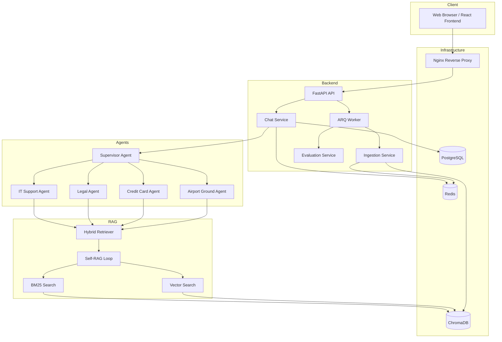
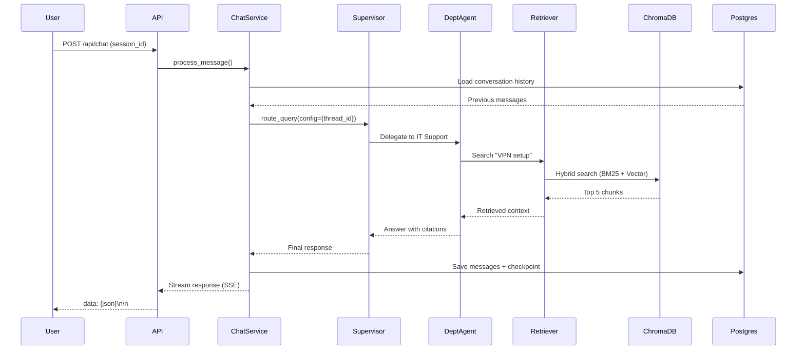
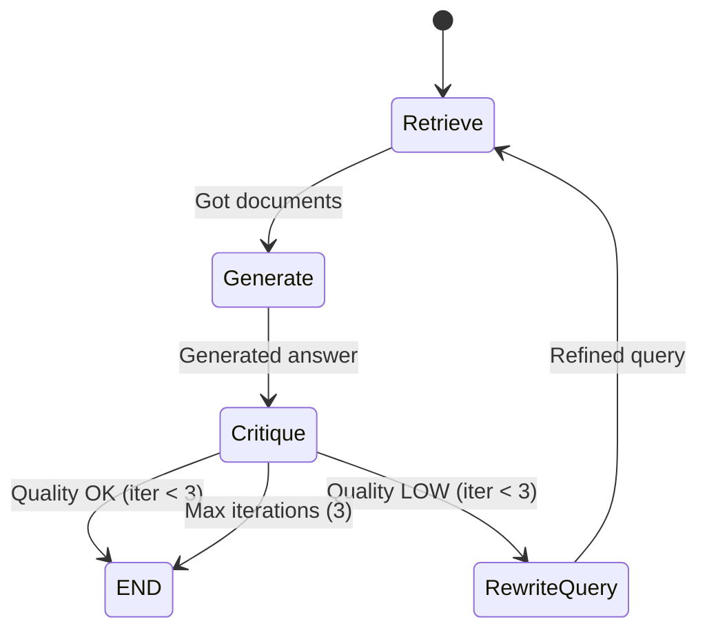

# SkyWing Airlines - System Architecture

This document provides a detailed technical overview of the SkyWing Airlines Multi-Agent RAG System architecture, data flow, and core components.

## System Overview

The system is built as a distributed microservices architecture, orchestrated via Docker Compose. It leverages a multi-agent approach for intelligent query routing and specialized knowledge retrieval.

### High-Level Architecture

## Component Responsibilities

### 1. Gateway & API Layer
- **Nginx**: Acts as the entry point, handling reverse proxying, SSL termination, and critical Server-Sent Events (SSE) configurations (disabling proxy buffering).
- **FastAPI**: Provides the RESTful interface for the system. It handles request validation (Pydantic), dependency injection, and serves both synchronous and streaming (SSE) responses.

### 2. Multi-Agent Orchestration
- **Supervisor Agent**: Built using `langgraph_supervisor`. It analyzes user queries to determine which department(s) are best suited to answer. It can route to a single agent or coordinate multiple agents for complex, cross-departmental queries.
- **Department Agents**: Specialized ReAct agents (IT Support, Legal, Credit Card, Airport Ground) created via `langgraph.prebuilt.create_react_agent`. Each agent has access to its own specialized knowledge base.

### 3. Self-RAG & Retrieval
- **Self-RAG Loop**: A LangGraph StateGraph that implements a critique-and-refinement loop.
    - **Retrieve**: Fetches documents using the Hybrid Retriever.
    - **Generate**: Produces an initial answer based on retrieved context.
    - **Critique**: Evaluates if the answer is grounded in facts and relevant to the query.
    - **Rewrite Query**: If the critique fails, it rewrites the search query to improve retrieval precision for the next iteration.
    - **Iteration Limit**: Capped at 3 iterations to prevent infinite loops and ensure low latency.
- **Hybrid Retriever**: Combines two search strategies:
    - **BM25 (40% weight)**: Keyword-based full-text search for exact terminology matches.
    - **Vector Search (60% weight)**: Semantic similarity search using `bge-base-en-v1.5` embeddings.
    - **Fusion**: Results are merged using Reciprocal Rank Fusion (RRF).

### 4. Storage & Memory
- **Parent-Child Chunking**:
    - **Child Chunks (~200 tokens)**: Stored in ChromaDB for high-precision semantic search.
    - **Parent Documents (~1000 tokens)**: Stored in Redis (DB 0). When a child chunk is retrieved, its parent document is fetched to provide the LLM with broader context, reducing hallucinations and improving coherence.
- **Three-Tier Memory**:
    - **Short-term**: LangGraph State maintains the context of the current graph execution.
    - **Medium-term**: `AsyncPostgresSaver` provides persistent checkpoints indexed by `thread_id` (session ID), enabling multi-turn conversations and state recovery.
    - **Long-term**: PostgreSQL stores the full conversation history (messages, sources, traces), while ChromaDB holds the persistent knowledge base.

## Data Flow Patterns

### Chat Interaction Sequence

### Self-RAG State Machine

## Background Tasks

The system uses **ARQ** (Async Redis Queue) on Redis DB 1 for non-blocking operations:
- **Knowledge Ingestion**: Processing and chunking new markdown documents into the vector store.
- **RAGAS Evaluation**: Running automated quality metrics (faithfulness, relevancy, precision, recall) on conversation pairs.

## Design Decisions Rationale

- **LangGraph**: Chosen for its native support for stateful, multi-agent workflows and robust checkpointing.
- **SSE (Server-Sent Events)**: Selected over WebSockets for simpler unidirectional streaming and better compatibility with Nginx buffering defaults.
- **ChromaDB**: Used for its lightweight footprint and Python-native integration, ideal for this scale of deployment.
- **AsyncPostgresSaver**: Ensures that even if a service restarts, the agent's conversation state is preserved in the relational database.
