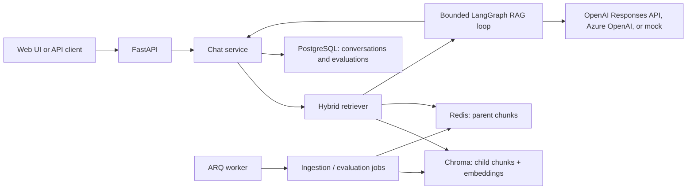
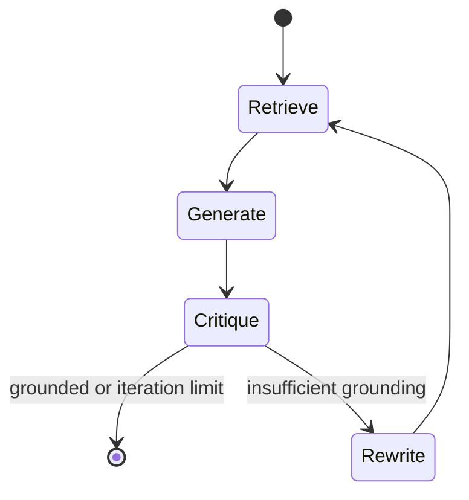

# Universal RAG architecture

## Overview

Universal RAG discovers knowledge bases from first-level directories under
`data/`. A request can target one knowledge base or omit `knowledge_base` to
search all indexed collections. No code or routing agent needs to be added when
a new domain is introduced.

## Ingestion

1. `IngestionService` discovers directories under the configured `DATA_DIR`.
2. Loaders read Markdown, text, reStructuredText, HTML, JSON, CSV, and PDF.
3. Text is split into parent chunks for context and smaller child chunks for
   retrieval precision.
4. Stable SHA-256 identifiers make repeated indexing idempotent.
5. The configured embedding provider embeds every child chunk explicitly.
6. Child chunks are upserted into a `kb_<slug>` Chroma collection; parent
   chunks are stored in Redis using the same parent identifier.

Changing the embedding provider or model requires rebuilding the collection
because vectors from different embedding spaces cannot be compared safely.

## Retrieval and generation

The retriever runs semantic vector search and BM25 lexical search, then merges
the ranked lists with reciprocal-rank fusion. If no knowledge base is selected,
the same bounded retrieval runs across all discovered collections.

Retrieved passages are numbered and treated as untrusted data. The model is
instructed to answer from those passages, ignore instructions embedded inside
them, match the user's language, and cite source numbers. The loop has a fixed
iteration cap so retry behavior and latency remain bounded.

## Storage

- **Chroma**: collection-per-knowledge-base child chunks and vectors.
- **Redis DB 0**: parent chunks used to expand retrieved context.
- **Redis DB 1**: ARQ background-job queue.
- **PostgreSQL**: conversations, messages, sources, traces, and evaluation
  results.

The PostgreSQL conversation column still has the legacy name `department` for
migration compatibility. It stores a knowledge-base slug or `all`; public APIs
use `knowledge_base`.

## Interfaces and operations

- `POST /api/v1/chat`: complete JSON response.
- `POST /api/v1/chat/stream`: Server-Sent Events.
- `GET /api/v1/knowledge-bases`: indexed collections and chunk counts.
- `GET /api/v1/health`: container and load-balancer health endpoint.
- `/api/v1/evaluation/*`: queued Ragas evaluation workflow.

Docker Compose pins service versions and persists PostgreSQL, Redis, and Chroma
data in named volumes. Chroma uses `/data` and its v2 heartbeat endpoint.
